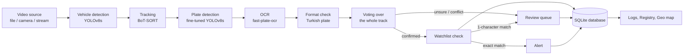
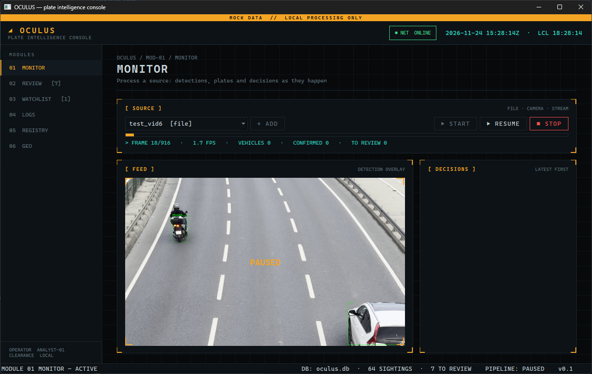
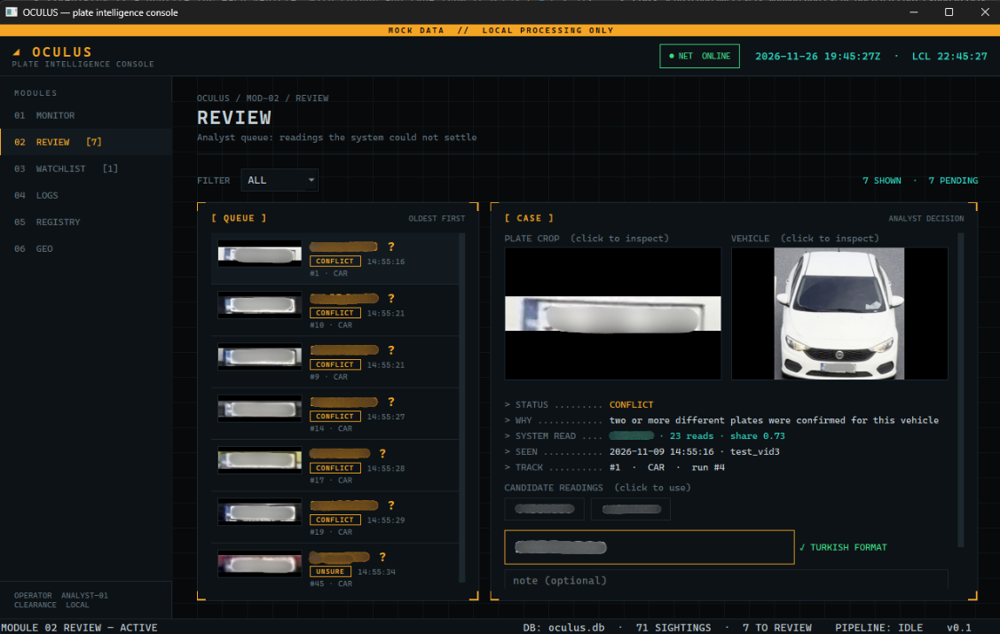
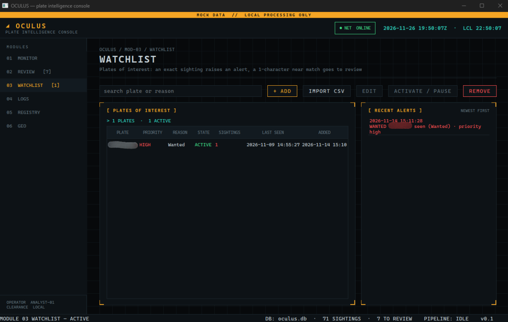
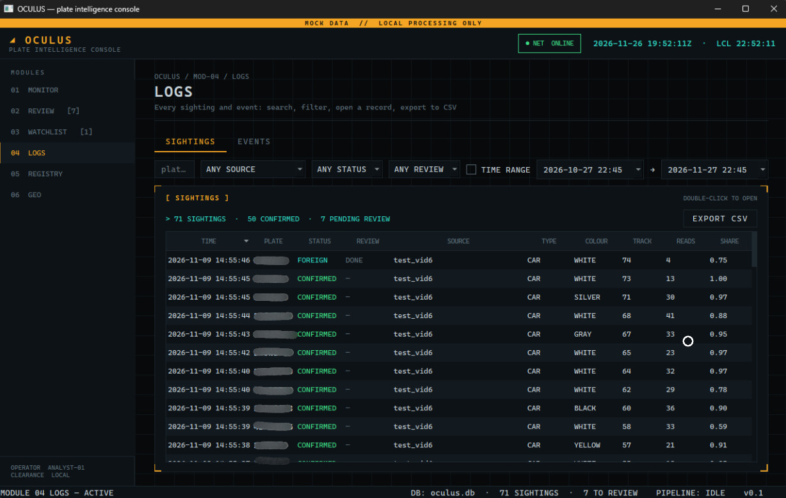
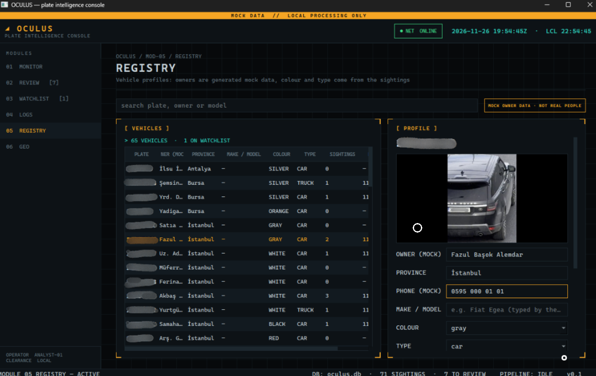
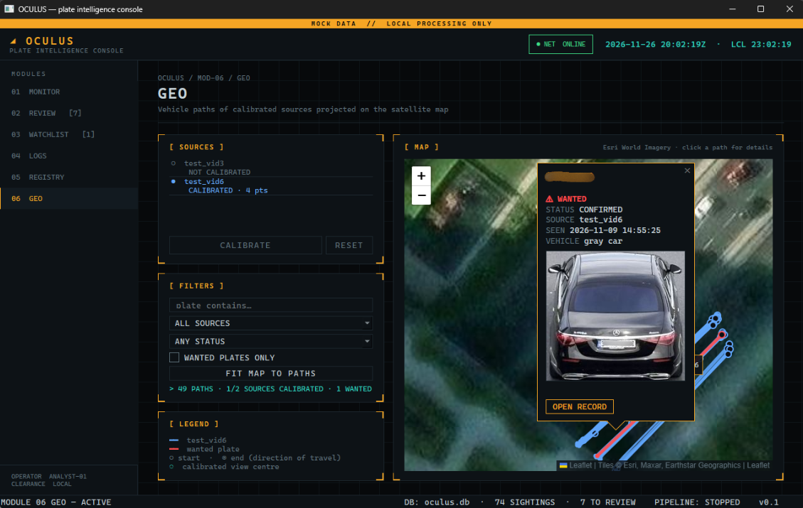

# OCULUS

**Smart Vehicle Plate Recognition and Activity Monitoring System**

OCULUS is a desktop application that finds vehicles in video, reads their Turkish licence plates and keeps a searchable record of every sighting. Readings the system is not sure about go to a human analyst for review. Plates on a watchlist raise an alert. Vehicle paths can be shown on a satellite map.

Built as a solo course project for SEN4015.

> **Restricted licence.** This repository is public only so people can see the author's work. It is **not** open source. Read the [LICENSE](LICENSE) and the [Responsible Use Policy](RESPONSIBLE_USE.md) before running it.

## Features

- **Vehicle detection and tracking:** YOLOv8s finds cars, motorcycles, buses and trucks. BoT-SORT gives each vehicle a track ID across frames.
- **Plate detection:** a YOLOv8s model fine-tuned on Turkish plates (mAP50 0.991).
- **Plate reading (OCR):** fast-plate-ocr reads the characters, and the text is checked against the Turkish plate format.
- **Voting:** each plate is read many times along its track. Reads are combined into one decision: confirmed, needs review, conflict or foreign.
- **Review queue:** an analyst accepts, corrects, rejects or marks a reading as foreign.
- **Watchlist:** an exact match raises an alert. A match that is one character off goes to review.
- **Registry:** a profile for each vehicle, with colour and type from the sightings. Owner data is generated **mock** data.
- **Logs:** search and filter every sighting and event, open a record, export to CSV.
- **Geo map:** calibrate a camera view against a satellite map (homography), then see vehicle paths on the map.
- **Connectivity indicator:** shows whether the map is available. The rest of the app works offline.

## How it works



1. Each frame is read from the source. YOLOv8s finds vehicles, and BoT-SORT gives each vehicle the same ID across frames.
2. For each tracked vehicle, the plate detector finds the plate, and OCR reads its characters.
3. A single read is often wrong, so every read along the track is kept. When the vehicle leaves, the reads are combined by voting. Larger, clearer plate images count more.
4. The result is one decision per vehicle: **confirmed**, **needs review**, **conflict** (two different plates confirmed) or **foreign**.
5. Confirmed plates are checked against the watchlist. Unsure readings and near matches go to an analyst.
6. Every sighting is saved with its plate crop, vehicle crop, colour, type and path. The Geo page projects these paths onto a satellite map through a homography built from 4 or more calibration points.

## Screenshots

Plates in the screenshots are blurred.

**Monitor:** processing a video with the detection overlay


**Review:** analyst queue with plate and vehicle crops


**Watchlist:** plates of interest and recent alerts


**Logs:** every sighting with filters and CSV export


**Registry:** vehicle profiles with mock owner data


**Geo:** vehicle paths on the satellite map, with a wanted plate in red


## Pages

| # | Page | Purpose |
|---|---|---|
| 01 | Monitor | Process a source and watch detections, plates and decisions as they happen |
| 02 | Review | Analyst queue for readings the system could not settle |
| 03 | Watchlist | Plates of interest and their alerts |
| 04 | Logs | Every sighting and event, with search, filters and CSV export |
| 05 | Registry | Vehicle profiles |
| 06 | Geo | Camera calibration and vehicle paths on the map |

## Project structure

```
app/
  vehicles/      vehicle detection and tracking
  plates/        plate detection and OCR
  aggregation/   voting over many reads of one track
  services/      review, watchlist, registry, colour, geo, recorder
  storage/       SQLite database, repositories, plate crops
  video/         video sources (file, camera, stream)
  gui/           PySide6 desktop app and its pages
tests/           basic unit tests
main.py          simple OpenCV preview without the GUI
```

## Requirements

- Python 3.13
- Windows was used for development. Other systems are not tested.
- An internet connection only for the Geo map

### Model weights

Model weights (`*.pt`) are **not** included in the repository.

- `yolov8s.pt` is downloaded by Ultralytics on the first run.
- The plate detector must be placed at `models/plate_1.pt`. It is available from the author for evaluation. Without it, OCULUS detects vehicles only.

## Installation

```powershell
python -m venv .venv
.venv\Scripts\activate
pip install -r requirements.txt
```

## Running

Desktop application:

```powershell
python -m app.gui
```

Simple preview window without the GUI (press `q` to exit):

```powershell
python main.py --source path\to\video.mp4
```

The database and plate crops are stored in `data/`, which is created on the first run.

## Tests

```powershell
python -m pytest
```

The suite has 70 basic tests. They cover plate format and normalisation, voting, homography, colour classification, the database and the services. Each test uses its own temporary database. The GUI and the ML models are not covered.

## Privacy

- No video, plate images, crops or databases are stored in this repository.
- All processing runs locally. Nothing is sent to the cloud. The only network use is loading the map library and the map tiles.
- Owner names and phone numbers in the registry are generated mock data.
- A responsible-use notice is shown when the app starts.

See [RESPONSIBLE_USE.md](RESPONSIBLE_USE.md) for the full policy, including KVKK (Law No. 6698).

## Future work

- Smart search across sightings
- Full test coverage, including the GUI and the pipeline
- Tracking the same vehicle across different camera views
- Live camera streams

## Third-party components

OCULUS uses Ultralytics YOLOv8, BoT-SORT, fast-plate-ocr, OpenCV, PySide6, Leaflet, Esri World Imagery and other components. The plate detector was trained on the *plaka_okuma* dataset (CC BY 4.0). See [SOURCES.md](SOURCES.md) for licences, attribution and references.

## Licence

Copyright (c) 2026 Muhammed Taş. All rights reserved.

Viewing, evaluation and personal learning only. See [LICENSE](LICENSE).

---

*This README was written with the help of AI (Claude by Anthropic) and was reviewed and checked by the author.*
